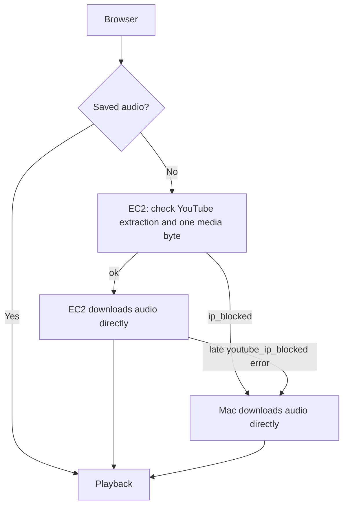

## YouTube download routing

On an IndexedDB cache miss, the website calls EC2's
`https://jerryzhou.ca/ytdlp/probe?url=...` first. An `ok` result selects EC2's
`/download`. An `ip_blocked` result selects
`https://downloads.jerryzhou.ca/download`, served by the owner's Mac through
Cloudflare Tunnel; visitors do not need a local app.

The API defines what counts as a block. Ordinary server/network errors, unavailable
videos, and cancellation do not silently select the Mac. The probe has a
16-second client deadline. Both download routes retain bounded retries and
cancellation, and partial audio is never cached. A late structured EC2 block
switches to the Mac once without retrying the blocked EC2 route.

Deploy the companion API change first: it introduces `/probe` and the structured
`youtube_ip_blocked` download error. `npm test` checks primary selection,
fallback selection, late blocks, probe timeout, permanent errors, and cancellation.
